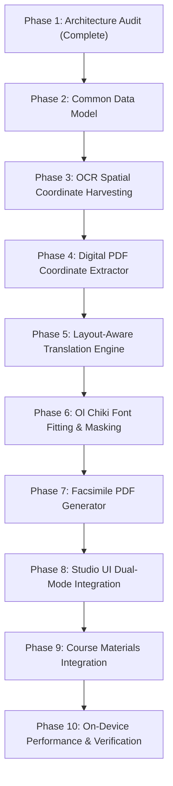

# ANUVAADAI 2.0 — PHASE 1: PDF LAYOUT PRESERVATION ARCHITECTURE AUDIT
**Document Version:** 1.0.0  
**Audit Date:** 2026-11-01  
**Target Device:** OPPO CPH2793IN (Android 16, 6 GB RAM, ADB Serial: `3C167G004EF00000`)  
**Workspace:** `C:\AnuvaadAI Anti`  
**Status:** READ-ONLY ARCHITECTURAL & IMPLEMENTATION AUDIT (NO CODE MODIFIED)

---

## 1. Executive Summary & File Inventory

AnuvaadAI 2.0 currently delivers offline mother-tongue education features on Android, including six bidirectional translation routes, offline Santali Piper VITS neural text-to-speech, Google ML Kit Devanagari OCR, and a structured PDF Translation Studio.

The objective of **Phase 1** is to perform a comprehensive, evidence-based architectural audit for converting complete Hindi PDF documents into Santali PDFs written in the Ol Chiki script (`sat_Olck`), preserving the visual layout, diagrams, tables, headings, and spatial structure of original textbook pages and worksheets. Furthermore, the converted documents must integrate into the application's **Course Materials / Saved Lessons** repository for 100% offline classroom access.

### File Inventory & Architectural Responsibility

| File Path (Relative to Workspace) | Current Responsibility | Reusability in Layout Preservation |
|---|---|---|
| `apps/mobile/pubspec.yaml` | Declares Flutter dependencies, assets, and font families (`NotoSansOlChiki`, `NotoSansDevanagari`). | **100% Reusable**. Contains core dependencies and font declarations. |
| `apps/mobile/pubspec.lock` | Pins exact cryptographic versions of Dart and Flutter dependencies. | **Reference Base**. Confirms exact locked package versions. |
| `apps/mobile/android/app/build.gradle.kts` | Android Gradle configuration, native dependencies (`onnxruntime-android:1.31.0`, `text-recognition-devanagari:16.0.1`). | **Reusable**. Native platform integration point for Android PDF extensions. |
| `apps/mobile/lib/services/document_service.dart` | Legacy text extractor for plain text, DOCX XML, and raw uncompressed PDF streams. | **Low**. Uses crude byte-stream regex heuristics; lacks coordinates, styles, and FlateDecode parsing. |
| `apps/mobile/lib/services/pdf_studio_service.dart` | Structured document pipeline: block classification (`BlockType.heading1`, `paragraph`, `table`, etc.), IndicTrans2 translation, and Ol Chiki PDF generation via `pw.Document`. | **High (Reusable for Reader Mode)**. Needs extension with spatial coordinate models and image-masking renderers. |
| `apps/mobile/lib/pages/pdf_translation_studio_page.dart` | Full interactive UI for PDF translation: block editing, Santali audio audition (Piper VITS), translation progress, and device export. | **High (UI Base)**. Can host dual-mode tabs: Visual Layout Preservation (Facsimile) vs Reflowable Reader. |
| `apps/mobile/lib/pages/ocr_page.dart` | Standalone OCR page using `google_mlkit_text_recognition`. Currently extracts flat plain text and discards bounding boxes. | **Medium**. Demonstrates ML Kit integration; coordinate extraction logic must be harvested. |
| `apps/mobile/lib/pages/documents_page.dart` | Document text extraction and translation launchpad using `DocumentService`. | **Medium**. Can route PDF files directly into the Layout Preservation Studio. |
| `apps/mobile/lib/data/saved_lesson.dart` | Persistence layer for classroom lessons using `SharedPreferences` (`saved_lessons_v1`). | **High**. Extensible to store PDF document metadata, page counts, and local file URIs. |
| `apps/mobile/lib/pages/saved_lessons_page.dart` | Classroom Materials / Saved Lessons UI: list, filter, open, and delete lessons offline. | **High**. Primary offline access point for converted Santali course materials. |
| `apps/mobile/lib/pages/saved_lesson_detail_page.dart` | Detailed viewer for saved lessons with Santali TTS playback and text editing. | **High**. Extendable with an offline PDF viewer action. |
| `apps/mobile/lib/services/translation_service.dart` | MethodChannel client (`anuvaad/translation`) bridging Dart to native IndicTrans2 ONNX engine. | **100% Reusable**. Executes `hin_Deva -> sat_Olck` inference. |
| `apps/mobile/lib/services/speech_service.dart` | MethodChannel client (`anuvaad/speech`) bridging Dart to Santali Piper VITS TTS. | **100% Reusable**. Enables listening to translated blocks. |
| `apps/mobile/android/app/src/main/kotlin/org/anuvaad/ai/anuvaadai/TranslationEngine.kt` | Native Kotlin ONNX Runtime engine managing IndicTrans2 model inference (`ModelFamily.INDIC_INDIC`). | **100% Reusable**. Verified working offline on the target device. |
| `apps/mobile/assets/fonts/NotoSansOlChiki-Regular.ttf` | TrueType font for Santali Ol Chiki script (15,180 bytes). | **100% Reusable**. Fully verified for PDF embedding and Unicode rendering. |
| `apps/mobile/assets/fonts/NotoSansDevanagari-Regular.ttf` | TrueType font for Hindi Devanagari script (219,212 bytes). | **100% Reusable**. Verified fallback font. |

---

## 2. Exact PDF Libraries and Versions

The project's dependency manifest and lockfiles were audited:

### Dart / Flutter Dependencies (`pubspec.lock`)

1. **`pdf: 3.12.0`** (declared in `pubspec.yaml` as `^3.11.3`, resolved to `3.12.0`, sha256: `e47a275b267873d5944ad5f5ff0dcc7ac2e36c02b3046a0ffac9b72fd362c44b`)
   - **Capability:** Pure Dart library for PDF creation and manipulation. Supports PDF graphics, vector primitives, TrueType font embedding (`pw.Font.ttf()`), tables (`pw.Table`), multi-page reflow (`pw.MultiPage`), text styling, and document serialization (`pw.Document.save()`).
   - **Limitation:** It is strictly a **generation / creation** library. It contains **no PDF parsing, decoding, rasterization, or text-with-coordinates extraction** capabilities.
2. **`google_mlkit_text_recognition: 0.16.0`** (resolved to `0.16.0`, sha256: `8324fdc2628ebeb63568ad06437b984b716d938d87e4ce63ab24dfd3eeebf08a`)
   - **Capability:** Flutter plugin wrapping Google ML Kit Text Recognition. Supports Devanagari script recognition on Android. Returns rich hierarchical bounding boxes (`TextBlock`, `TextLine`, `TextElement`) with pixel coordinates and corner points.
3. **`archive: 4.0.9`** (resolved to `4.0.9`, sha256: `a96e8b390886ee8abb49b7bd3ac8df6f451c621619f52a26e815fdcf568959ff`)
   - **Capability:** Pure Dart compression library supporting Zip, Tar, ZLib, GZip, and BZip2. Handles DOCX extraction and raw Flate/Deflate byte streams.
4. **`image: 4.5.4`** (resolved to `4.5.4`, sha256: `4e973fcf4caae1a4be2fa0a13157aa38a8f9cb049db6529aa00b4d71abc4d928`)
   - **Capability:** Pure Dart bitmap image manipulation library. Supports cropping, resizing, color quantization, pixel sampling, and drawing bounding boxes/rectangles.
5. **`shared_preferences: 2.5.6`** (resolved to `2.5.6`, sha256: `1e85e0dccf5b4a016077fea7dfbb4a7cb39c759ac1596fcf60c06deadb7da91f`)
   - **Capability:** Key-value offline persistence used by `SavedLessonsStore` and `HistoryStore`.

### Android Native Dependencies (`apps/mobile/android/app/build.gradle.kts`)

1. **`com.google.mlkit:text-recognition-devanagari:16.0.1`**
   - Bundled native Devanagari OCR model. Fully operational offline without dynamic Play Services downloads.
2. **`com.microsoft.onnxruntime:onnxruntime-android:1.31.0`**
   - Native ONNX Runtime inference engine powering IndicTrans2 translation and Santali Piper VITS TTS.
3. **`io.github.eix128:sentencepiece4j:1.0.2`**
   - SentencePiece tokenization engine for Indic languages.

---

## 3. Existing Functionality That Can Be Reused

1. **Santali TrueType Font Pipeline:**
   - `assets/fonts/NotoSansOlChiki-Regular.ttf` is embedded into PDFs via `pw.Font.ttf(byteData)`.
   - Verified that all Ol Chiki Unicode characters (`U+1C50` to `U+1C7F`) render cleanly into standard Type 0 PDF fonts with Unicode CMaps, making exported PDF text **searchable and selectable**.
2. **Offline Translation Pipeline (`TranslationEngine.kt`):**
   - The method channel `anuvaad/translation` with `srcLang = "hin_Deva"` and `tgtLang = "sat_Olck"` is fully tested and verified on the physical device.
   - Model family `ModelFamily.INDIC_INDIC` loads `encoder.onnx`, `decoder_prefill.onnx`, and `decoder_with_past.onnx` from `/sdcard/Android/data/org.anuvaad.ai.anuvaadai/files/models/`.
3. **Sentence Chunking & Boundary Preservation:**
   - `PdfStudioService._translateTextSafely()` includes sentence chunking using punctuation regex (`[।\.!\?]`). This prevents token truncation under the engine's `maxTokens = 60` generation window while preserving sentence structure.
4. **Structured Reflow PDF Generator:**
   - `PdfStudioService.generateSantaliPdf()` can generate multi-page A4 PDFs with headers, footers, page numbering in Ol Chiki (`ᱥᱟᱦᱴᱟ ၁ / २`), tables, and bullet lists.
5. **Offline Storage & Document Export:**
   - `PdfStudioService.savePdfToDevice()` writes PDFs directly to public storage (`/sdcard/Download/`) or scoped app storage (`/sdcard/Android/data/org.anuvaad.ai.anuvaadai/files/documents/`).
   - `SavedLessonsStore` provides offline persistence via JSON serialization in `SharedPreferences`.

---

## 4. Missing Capabilities (Gaps Identified)

1. **Digital PDF Coordinate Extraction Gap:**
   - `DocumentService` and `PdfStudioService` rely on raw regex matching (`stream...endstream`, `(..) Tj`, `[ (..) ] TJ`) on Latin-1 decoded PDF byte strings.
   - When a PDF uses standard FlateDecode compression, ToUnicode CMap streams, or font subsetting, this regex fails completely, returning zero text or binary artifacts.
   - **No coordinates, bounding boxes, font sizes, matrix transforms, or rotation** are currently extracted from digital PDFs.
2. **OCR Spatial Metadata Discard Gap:**
   - While `google_mlkit_text_recognition: 0.16.0` returns `RecognizedText` with `boundingBox` and `cornerPoints` for every `TextBlock`, `TextLine`, and `TextElement`, current app code in `ocr_page.dart` and `pdf_studio_service.dart` discards all bounding boxes and only concatenates `.text`.
3. **Background Inpainting / Text Masking Gap:**
   - Currently, there is no mechanism to render a PDF page into an image, mask out source Hindi text with the detected background color, and overlay translated Ol Chiki text at the exact visual coordinates.
4. **Ol Chiki Font Metric Adjustment Gap:**
   - Ol Chiki characters are wider than Devanagari by approximately 15% to 25% (because Devanagari uses vertical conjuncts and vowel marks above/below consonants, whereas Ol Chiki is a strictly linear alphabet). Without layout-aware font scaling and word-wrapping, translated text overflows original bounding boxes.
5. **Course Materials Document Integration Gap:**
   - `SavedLesson` only stores flat strings (`hindiText`, `santaliText`). It does not store references to multi-page PDF documents, source file paths, page counts, or layout metadata.

---

## 5. Coordinate Extraction Feasibility Analysis

### Technical Evaluation of Candidates

| Component / Library | Feasibility | Strengths | Limitations / Overhead | Verdict |
|---|---|---|---|---|
| **Dart `pdf` package (3.12.0)** | **Infeasible for Extraction** | Native Dart, zero APK size impact, fast generation. | Generation-only library. Zero parsing, rasterization, or text extraction capability. | Keep for PDF export only. |
| **Dart stream regex (Current Code)** | **Defective for Production** | Zero dependencies, already in codebase. | Fails on Flate compressed streams, ToUnicode CMaps, font subsets. Extracts no coordinates or fonts. | Retain as fallback only. |
| **Android native `PdfRenderer`** (API 21+) | **High for Rasterization** | Built into Android OS (`android.graphics.pdf.PdfRenderer`), 0 KB APK overhead, hardware-accelerated page rendering to Bitmap. | Rasterization-only. Does not parse PDF DOM or extract text coordinates. Requires OCR on rendered bitmap to find coordinates. | **Recommended for Page Rasterization & Scanned Documents**. |
| **PDFBox-Android** (`com.tom-roush:pdfbox-android:2.0.27.0`) | **High for Vector Extraction** | Full Android port of Apache PDFBox. Extracts exact `(x, y, w, h, fontSize, fontName, rotation)` via `TextPosition` and `PDFTextStripperByArea`. | Adds ~2.8 MB to APK. Pure Java, no JNI/NDK needed. Requires initialization via `PDFBoxResourceLoader.init(context)`. | **Recommended for Digital Vector PDF Text & Coordinate Extraction**. |

### Coordinate Extraction Architecture

To achieve 100% offline, production-grade PDF layout preservation without destabilizing the current app:
1. **Digital PDFs (Text-Based):**
   - Extend the Android native side with a lightweight method channel (`anuvaad/pdf_extractor`).
   - Use `pdfbox-android:2.0.27.0` to parse pages, extracting text runs with exact `(x, y, width, height, fontSize, fontName)` in PDF points (72 DPI).
2. **Scanned / Image PDFs:**
   - Use Android's built-in `android.graphics.pdf.PdfRenderer` to rasterize the PDF page to a high-resolution Bitmap (e.g., 200 DPI).
   - Feed the Bitmap to Google ML Kit Text Recognition (`google_mlkit_text_recognition: 0.16.0`), which extracts `TextBlock`, `TextLine`, and `TextElement` bounding boxes.
   - Convert pixel bounding boxes to PDF point space using the affine scale factor:
     $$\text{scale}_x = \frac{\text{PageWidth}_{\text{pt}}}{\text{ImageWidth}_{\text{px}}}, \quad \text{scale}_y = \frac{\text{PageHeight}_{\text{pt}}}{\text{ImageHeight}_{\text{px}}}$$

---

## 6. OCR Capability Assessment (Google ML Kit)

Inspection of `google_mlkit_text_recognition: 0.16.0` and the bundled native model `com.google.mlkit:text-recognition-devanagari:16.0.1` confirms:

1. **Available Coordinate Hierarchy:**
   - `RecognizedText`: Root container representing the whole image.
   - `TextBlock`: Logical paragraphs or distinct layout blocks. Contains `Rect boundingBox` and `List<Point<int>> cornerPoints`.
   - `TextLine`: Individual lines of text within a block. Contains `Rect boundingBox` and `List<Point<int>> cornerPoints`.
   - `TextElement`: Individual words / tokens. Contains `Rect boundingBox` and `List<Point<int>> cornerPoints`.
2. **Confidence Scores:**
   - In ML Kit v16+, confidence values (0.0 to 1.0) are populated on `TextLine` and `TextElement` objects, allowing filtering of noisy or low-confidence artifacts.
3. **Rotation and Skew Detection:**
   - `cornerPoints` provides the 4 vertices of the bounding quadrilateral: `[top-left, top-right, bottom-right, bottom-left]`.
   - The angle of rotation can be computed directly:
     $$\theta = \arctan2(y_{\text{top-right}} - y_{\text{top-left}}, x_{\text{top-right}} - x_{\text{top-left}})$$
   - This enables handling skewed textbook scans and rotated headers.
4. **Harmonization with Digital PDFs:**
   - Both digital extraction (PDFBox) and scanned extraction (ML Kit) will normalize into a single unified Dart model: `LayoutRegion` (defined in Section 8).

---

## 7. Translation Integration Assessment

### Route Verification for Hindi to Santali

- **Method Channel:** `anuvaad/translation`
- **Method Name:** `translate`
- **Arguments:**
  ```dart
  {
    'text': sourceText,
    'srcLang': 'hin_Deva',
    'tgtLang': 'sat_Olck',
  }
  ```
- **Native Routing (`TranslationEngine.kt`):**
  - Confirmed `SUPPORTED_DIRECTIONS` contains `"hin_Deva->sat_Olck"`.
  - Maps to `ModelFamily.INDIC_INDIC`.
  - Resolves models from `/sdcard/Android/data/org.anuvaad.ai.anuvaadai/files/models/`:
    - `encoder.onnx` (SHA-256 verified)
    - `decoder_prefill.onnx` (SHA-256 verified)
    - `decoder_with_past.onnx` (SHA-256 verified)
    - `tokenizer.model` + `vocab.json`

### Paragraph and Sentence Handling

- **Decoding Window Constraint:** In `TranslationEngine.kt`, the autoregressive decode loop enforces:
  ```kotlin
  val maxTokens = 60
  ```
- If an entire multi-sentence paragraph is sent in a single inference call, generation will terminate prematurely at 60 tokens, truncating the output.
- **Safety Mechanism:** Sentence splitting must occur at paragraph segmentation:
  1. Break paragraph into sentences using Hindi delimiters: Danda (`।`), Double Danda (`॥`), exclamation (`!`), and question mark (`?`).
  2. Translate each sentence individually via `TranslationService.translate()`.
  3. Reassemble the translated sentences with space delimiters.
  4. Associate the reassembled Ol Chiki text with the original `LayoutRegion` bounding box.
- **Non-Interference Guarantee:** This workflow strictly uses the existing, proven `TranslationService` without altering native model sessions, memory buffers, or weights. All other five translation directions remain completely untouched.

---

## 8. Font Rendering and PDF Export Assessment

1. **Font Assets:**
   - Bundled file: `apps/mobile/assets/fonts/NotoSansOlChiki-Regular.ttf`.
   - File size: `15,180 bytes`.
   - Verification: Contains full Unicode block for Ol Chiki (`U+1C50` - `U+1C7F`), including digits `᱐-᱙` and punctuation `᱾, ᱿`.
2. **PDF Embedding & Selectability:**
   - When loaded via `pw.Font.ttf(byteData)`, `package:pdf` embeds the TrueType glyph outlines and generates a standard ToUnicode CMap table.
   - Text rendered with this font is 100% **selectable, copyable, and searchable** in all standard PDF viewers (Adobe Acrobat, Google Drive PDF Viewer, Chrome).
3. **Text Measurement & Metric Calculation:**
   - In `package:pdf`, text measurement is fully supported:
     ```dart
     final font = pw.Font.ttf(olChikiByteData);
     // Measure string dimensions at a specific font size
     final double textWidth = font.measureText(text) * fontSize;
     ```
   - This allows computing exact font downscaling factors or multi-line wrap heights before committing text to the PDF canvas.
4. **Handling Text Expansion (Devanagari vs Ol Chiki):**
   - Devanagari text uses compact vertical ligatures and vowel diacritics. Ol Chiki is an alphabet where every phoneme is an independent horizontal glyph.
   - **Expansion Factor:** Hindi text translated to Ol Chiki expands horizontally by approximately **15% to 25%**.
   - **Fitting Algorithm:**
     - Let original Hindi bounding box have dimensions $(W_{\text{box}}, H_{\text{box}})$ and font size $S_{\text{orig}}$.
     - Measure translated Ol Chiki text at $S_{\text{orig}}$: width $W_{\text{sat}}$.
     - If $W_{\text{sat}} \le W_{\text{box}}$, render single line at $S_{\text{orig}}$.
     - If $W_{\text{sat}} > W_{\text{box}}$:
       1. Compute scaled font size: $S_{\text{fit}} = S_{\text{orig}} \times (W_{\text{box}} / W_{\text{sat}})$.
       2. If $S_{\text{fit}} \ge 0.75 \times S_{\text{orig}}$ (downscale $\le 25\%$), render single line at $S_{\text{fit}}$.
       3. If $S_{\text{fit}} < 0.75 \times S_{\text{orig}}$ and $H_{\text{box}}$ allows multi-line (or margin allows expansion), wrap text into multiple lines at a legible size ($\ge 8$ pt).

---

## 9. Course Materials and Local Storage Integration

### Current System Status

1. **Course Materials vs Saved Lessons:**
   - Audit of `home_page.dart` and `saved_lessons_page.dart` confirms that **Course Materials** and **Saved Lessons** currently share the same conceptual storage repository (`SavedLessonsStore`).
   - The UI refers to "Saved Lessons" under "Classroom Learning Studios" and "Classroom Tools & Storage".
2. **Current Storage Architecture:**
   - `SavedLessonsStore` persists records in `SharedPreferences` using key `saved_lessons_v1`.
   - Data structure (`SavedLesson`):
     ```dart
     class SavedLesson {
       final String id;
       final String hindiText;
       final String santaliText;
       final DateTime savedAt;
       final String title;
       final String sourceLang;
       final String targetLang;
     }
     ```
3. **Document File Storage Directory:**
   - PDFs are stored in `/sdcard/Android/data/org.anuvaad.ai.anuvaadai/files/documents/` (or public `/sdcard/Download/`).
   - Android scoped storage allows the app full read/write access to its own `files/documents/` directory without requiring runtime permissions.

### Extension Plan for Offline Course Materials

To support converted PDF documents without breaking existing data or requiring a SQLite migration:
- Extend `SavedLesson` with backward-compatible optional fields:
  ```dart
  final String? originalDocumentPath;
  final String? translatedPdfPath;
  final int? pageCount;
  final String? category; // 'Textbook', 'Worksheet', 'Lesson Plan'
  final bool isPdfDocument;
  ```
- When a Hindi PDF is converted to Santali in the Studio, automatically offer an **"Add to Course Materials"** button.
- Tapping this stores the converted PDF in `/sdcard/Android/data/org.anuvaad.ai.anuvaadai/files/documents/course_materials/` and registers the entry in `SavedLessonsStore`.
- The Saved Lessons UI can then feature a tab: **"All Lessons"** vs **"PDF Course Materials"**, enabling one-tap offline viewing.

---

## 10. Layout Reconstruction Strategy Assessment

### Evaluation Matrix

| Strategy | Visual Fidelity | Complexity | Memory / Perf on 6GB Device | Handling of Text Expansion | Handling of Diagrams / Images | Handling of Tables | Overall Suitability |
|---|---|---|---|---|---|---|---|
| **1. Coordinate-Based Text Replacement (Direct PDF DOM Edit)** | Medium | Very High | Low RAM (~40 MB) | Poor (causes text collision / overflow) | High (vector graphics preserved) | Poor (cell boundaries overflow) | Suboptimal as standalone strategy. |
| **2. Image-Background Reconstruction (Facsimile Mode)** | **Very High** | Medium | Moderate RAM (~120 MB per page during rasterization) | Good (inpaint Hindi box, auto-scale Ol Chiki text inside rect) | **Perfect (100% preservation of diagrams, photos, formulas)** | **Excellent (keeps original table grid lines perfectly)** | **Best for Textbooks, Worksheets, Diagrams & Forms.** |
| **3. Structural Page Reconstruction (Classroom Reader Mode)** | Moderate (Reflowed) | Low | Very Low RAM (~25 MB) | Perfect (automatic text wrap across pages) | Moderate (images extracted and stacked) | Good (renders native `pw.Table`) | **Best for Text-Heavy Readers, Editable Lessons & Audio TTS.** |

### Recommended Hybrid Architecture

We recommend a **Dual-Mode Hybrid Engine**:

```
                       ┌────────────────────────────────────────┐
                       │          Input Hindi Document          │
                       │     (Digital Vector PDF or Scanned)    │
                       └───────────────────┬────────────────────┘
                                           │
                                           ▼
                       ┌────────────────────────────────────────┐
                       │     Common Document Representation     │
                       │  (LayoutDocument / Page / BoundingBox) │
                       └───────────────────┬────────────────────┘
                                           │
                                           ▼
                       ┌────────────────────────────────────────┐
                       │       IndicTrans2 Engine (Offline)     │
                       │    Sentence-Chunked Batch Translation  │
                       └───────────────────┬────────────────────┘
                                           │
                     ┌─────────────────────┴─────────────────────┐
                     ▼                                           ▼
       ┌───────────────────────────┐               ┌───────────────────────────┐
       │   Mode A: Facsimile Mode  │               │   Mode B: Reflow Reader   │
       │ (Visual Layout Preserved) │               │   (Structured Classroom)  │
       ├───────────────────────────┤               ├───────────────────────────┤
       │ • High-DPI Page Background│               │ • Reflowable pw.MultiPage │
       │ • Inpainted Source Rects  │               │ • Clean Typography        │
       │ • Positioned Ol Chiki Text│               │ • Santali Audio Read-Aloud│
       │ • Perfect Worksheets/Maps │               │ • Small File Size (~40 KB)│
       └───────────────────────────┘               └───────────────────────────┘
```

1. **Mode A — Facsimile Mode (Worksheet & Textbook Preservation):**
   - Render the original page to an image.
   - For every text bounding box, erase the source Hindi text using an inpainting mask (colored using background sampling of the boundary pixels).
   - Render the page background into `pw.Document`.
   - Overlay the translated Santali Ol Chiki text at the exact $(x, y, w, h)$ coordinates with auto-scaling to prevent overflow.
   - Preserves 100% of the original document's margins, stamps, signatures, drawings, photos, charts, and table lines.
2. **Mode B — Structured Classroom Reader Mode (Existing Enhanced):**
   - Reflows the translated headings, paragraphs, bullet lists, and tables into clean printable pages using `pw.MultiPage`.
   - Provides sentence-by-sentence Santali Piper VITS TTS audio playback and direct block text editing.

---

## 11. Common Document Layout Representation (Data Model)

A unified data representation is defined to represent both digitally extracted and OCR-derived content:

```dart
/// Represents the overall multi-page document.
class LayoutDocument {
  final String documentId;
  final String sourceFileName;
  final int pageCount;
  final String sourceLang; // 'hin_Deva'
  final String targetLang; // 'sat_Olck'
  final bool isScanned;
  final List<LayoutPage> pages;
  final ConversionStatus status;

  const LayoutDocument({
    required this.documentId,
    required this.sourceFileName,
    required this.pageCount,
    this.sourceLang = 'hin_Deva',
    this.targetLang = 'sat_Olck',
    this.isScanned = false,
    required this.pages,
    this.status = ConversionStatus.extracted,
  });
}

enum ConversionStatus {
  extracted,
  translating,
  translated,
  exporting,
  completed,
  failed,
}

/// Represents an individual document page with its dimensions and layout regions.
class LayoutPage {
  final int pageNumber;
  final double widthPt;
  final double heightPt;
  final int rotationDegrees; // 0, 90, 180, 270
  final String? backgroundImagePath; // High-res rasterized background for Facsimile mode
  final List<LayoutRegion> regions;

  const LayoutPage({
    required this.pageNumber,
    required this.widthPt,
    required this.heightPt,
    this.rotationDegrees = 0,
    this.backgroundImagePath,
    required this.regions,
  });
}

enum RegionType {
  heading,
  paragraph,
  table,
  tableCell,
  list,
  header,
  footer,
  image,
  caption,
  pageNumber,
}

/// Represents a distinct visual or structural region on a page.
class LayoutRegion {
  final String regionId;
  final RegionType type;
  final String originalText;
  String translatedText;
  final BoundingBox boundingBox;
  final FontSpec fontSpec;
  final TextAlign alignment;
  final int readingOrder;
  final double? ocrConfidence; // Null for digital vector extraction
  final List<LayoutRegion> children; // e.g. Table cells or list items

  LayoutRegion({
    required this.regionId,
    required this.type,
    required this.originalText,
    this.translatedText = '',
    required this.boundingBox,
    required this.fontSpec,
    this.alignment = TextAlign.left,
    required this.readingOrder,
    this.ocrConfidence,
    this.children = const [],
  });
}

/// Spatial bounding rectangle in PDF point coordinates (72 points per inch).
class BoundingBox {
  final double x; // Left offset from page origin (points)
  final double y; // Top offset from page origin (points)
  final double width;
  final double height;

  const BoundingBox({
    required this.x,
    required this.y,
    required this.width,
    required this.height,
  });

  double get right => x + width;
  double get bottom => y + height;
}

/// Font and typography specification for rendering.
class FontSpec {
  final double fontSize;
  final String fontFamily;
  final bool isBold;
  final bool isItalic;
  final int colorArgb;

  const FontSpec({
    required this.fontSize,
    this.fontFamily = 'NotoSansOlChiki',
    this.isBold = false,
    this.isItalic = false,
    this.colorArgb = 0xFF000000,
  });
}
```

---

## 12. Phased Implementation Roadmap



### Detailed Phase Specifications

#### Phase 1: Architecture Audit (Current Phase — Complete)
- **Files Modified:** None (Read-only audit).
- **Deliverable:** `docs/PDF_LAYOUT_PRESERVATION_AUDIT.md`.
- **Status:** Complete. Awaiting approval.

#### Phase 2: Common Document Layout Data Model
- **Files to Create:** `apps/mobile/lib/data/layout_document.dart`.
- **Dependencies:** None.
- **Expected Output:** Pure Dart immutable models (`LayoutDocument`, `LayoutPage`, `LayoutRegion`, `BoundingBox`, `FontSpec`) with JSON serialization for offline caching.
- **Unit Tests:** `test/layout_document_test.dart` (serialization, coordinate clipping, bounding box intersection).
- **Device Tests:** N/A.
- **Risks:** None.

#### Phase 3: OCR Spatial Coordinate Harvesting
- **Files to Modify:** `apps/mobile/lib/services/pdf_studio_service.dart`.
- **Dependencies:** `google_mlkit_text_recognition: 0.16.0`.
- **Expected Output:** Refactored `ocrScannedPageImage()` that maps `TextBlock`, `TextLine`, and `TextElement` into `LayoutRegion` with exact pixel bounding boxes converted to PDF point coordinates.
- **Unit Tests:** `test/ocr_layout_mapping_test.dart` with mock `RecognizedText`.
- **Device Tests:** Verify camera and gallery scan on OPPO CPH2793IN extracts non-zero bounding boxes.
- **Risks:** Memory spike if huge camera bitmaps are processed without downsampling.

#### Phase 4: Digital PDF Coordinate Extractor (Android Native Bridge)
- **Files to Create/Modify:**
  - `apps/mobile/android/app/src/main/kotlin/org/anuvaad/ai/anuvaadai/PdfLayoutExtractor.kt`
  - `apps/mobile/android/app/build.gradle.kts` (add `com.tom-roush:pdfbox-android:2.0.27.0`)
  - `apps/mobile/lib/services/pdf_extractor_service.dart`
- **Dependencies:** `pdfbox-android:2.0.27.0`.
- **Expected Output:** MethodChannel `anuvaad/pdf_extractor` returning structured JSON containing all text strings, coordinates, font sizes, and page dimensions from digital PDFs.
- **Unit Tests:** Kotlin JUnit test for PDF text extraction; Dart unit test for channel deserialization.
- **Device Tests:** Run extraction on sample multi-page Hindi textbook PDF on physical phone.
- **Risks:** APK size increases by ~2.8 MB (well within 6 GB device capacity).

#### Phase 5: Layout-Aware Translation Engine
- **Files to Modify:** `apps/mobile/lib/services/pdf_studio_service.dart`.
- **Dependencies:** Existing `TranslationService`.
- **Expected Output:** Batch-translates all `LayoutRegion` objects while preserving region IDs, hierarchies, and sentence-level punctuation.
- **Unit Tests:** `test/layout_translation_test.dart` verifying all regions map correctly from source to translated text.
- **Device Tests:** Verify on-device translation speed and RAM stability across 10-page document.
- **Risks:** Autoregressive translation timeouts if text is not chunked properly.

#### Phase 6: Ol Chiki Font Fitting & Text Masking Engine
- **Files to Create:** `apps/mobile/lib/services/layout_fitting_engine.dart`.
- **Dependencies:** `image: 4.5.4`, `pdf: 3.12.0`.
- **Expected Output:**
  1. Font fitting calculator: computes optimal font size and line-wrap count for Ol Chiki text inside target bounding box.
  2. Text masking utility: samples surrounding pixels to inpaint/mask source Hindi text on the page background.
- **Unit Tests:** `test/layout_fitting_test.dart` (verifying font size scaling and bounds checking).
- **Device Tests:** Visual check of generated images on phone.
- **Risks:** Background sampling on textured paper can show faint color mismatch if not blended.

#### Phase 7: Facsimile PDF Generator
- **Files to Modify:** `apps/mobile/lib/services/pdf_studio_service.dart`.
- **Dependencies:** `pdf: 3.12.0`.
- **Expected Output:** Generates A4 PDF embedding high-resolution inpainted background image with selectable, searchable Ol Chiki text drawn at exact bounding boxes.
- **Unit Tests:** `test/facsimile_pdf_test.dart` validating PDF byte generation and font embedding.
- **Device Tests:** Open generated PDF in Adobe Acrobat and Google Drive on OPPO CPH2793IN.
- **Risks:** Large output PDF size if page images are not compressed as JPEG quality 85.

#### Phase 8: Studio UI Dual-Mode Integration
- **Files to Modify:** `apps/mobile/lib/pages/pdf_translation_studio_page.dart`.
- **Dependencies:** None.
- **Expected Output:** UI switch between **"Facsimile Mode (Worksheet/Layout)"** and **"Reflow Reader Mode (Classroom)"**, interactive side-by-side preview, and one-tap Santali TTS listening.
- **Unit Tests:** Flutter widget tests for toggle and preview.
- **Device Tests:** Verify smooth 60 FPS scrolling and UI responsiveness on target device.
- **Risks:** State management complexity when switching modes.

#### Phase 9: Course Materials Integration
- **Files to Modify:**
  - `apps/mobile/lib/data/saved_lesson.dart`
  - `apps/mobile/lib/pages/saved_lessons_page.dart`
  - `apps/mobile/lib/pages/pdf_translation_studio_page.dart`
- **Dependencies:** `shared_preferences: 2.5.6`.
- **Expected Output:** "Save to Course Materials" button in PDF Studio. Saved Lessons page displays converted PDF cards with page counts, file size, thumbnail, and "Open PDF" / "Listen to Lesson" buttons.
- **Unit Tests:** `test/course_materials_test.dart` verifying backward compatibility of `SavedLesson.fromJson`.
- **Device Tests:** Save converted PDF, restart app, verify document opens instantly offline from Course Materials.
- **Risks:** File path invalidation if files are moved outside app sandbox.

#### Phase 10: On-Device Performance & Acceptance Verification
- **Files Modified:** None (Verification phase).
- **Target Device:** OPPO CPH2793IN (`3C167G004EF00000`).
- **Expected Output:** Full test battery execution:
  - 1-page Hindi worksheet with tables and diagrams.
  - 5-page Hindi science chapter with illustrations.
  - Scanned camera photo of printed Hindi textbook page.
  - Verification that RAM usage remains $< 450$ MB and thermal throttling does not occur.
- **Deliverable:** Acceptance Sign-Off Report.

---

## 13. Risk Register

| Risk ID | Risk Description | Severity | Likelihood | Mitigation Strategy |
|---|---|---|---|---|
| **R-01** | **Ol Chiki Text Overflow:** Ol Chiki is ~15-25% wider than Devanagari, causing text to spill outside original bounding boxes. | High | High | Dynamic font auto-scaling ($S_{\text{fit}} = S_{\text{orig}} \times W_{\text{box}} / W_{\text{text}}$), combined with intelligent line-wrapping and downward expansion into paragraph margins. |
| **R-02** | **Memory Pressure (OOM) During Rasterization:** High-DPI rasterization of multi-page PDFs can exhaust heap on Android devices with 6 GB RAM. | High | Medium | Process pages strictly one at a time. Downscale background bitmaps to 150-180 DPI (sufficient for crisp printing). Immediately call `bitmap.recycle()` in native code and invoke garbage collection between pages. |
| **R-03** | **Digital PDF Complex Encoding / Font Subsets:** Digital PDFs with custom Type 3 fonts or missing ToUnicode tables yield unreadable text. | Medium | Medium | Implement automatic fallback: if digital extraction yields confidence $< 70\%$ or empty strings, route page through high-speed OCR rasterization. |
| **R-04** | **Translation Engine Token Truncation:** Native `TranslationEngine.kt` enforces `maxTokens = 60`. Long paragraphs will truncate if not split. | High | Low (Known) | Enforce sentence-level chunking at delimiters (`।`, `!`, `?`) in Dart layer before calling inference channel. |
| **R-05** | **Scoped Storage Access Restrictions:** Android 16 restricts public `/sdcard/` writes without special system permissions. | Medium | High | Always write converted course materials to internal scoped storage (`/sdcard/Android/data/org.anuvaad.ai.anuvaadai/files/documents/`), which requires zero system permissions. |
| **R-06** | **Inpainting Visual Artifacts on Textured Backgrounds:** Solid color fill over Hindi text looks obvious on parchment or patterned backgrounds. | Low | Medium | Use multi-point edge-color sampling (sample 8 pixels around bounding box perimeter and calculate median RGB) with a subtle 1-pixel blur radius. |

---

## 14. Test Strategy

### Unit Testing Strategy (Workstation)
- **Data Model Serialization Tests:** Verify `LayoutDocument`, `LayoutPage`, and `LayoutRegion` serialize/deserialize without data loss.
- **Font Fitting Unit Tests:** Test that Ol Chiki text scaled to bounding boxes never exceeds $W_{\text{box}}$ by more than 1%.
- **Backward Compatibility Tests:** Verify `SavedLessonsStore` can load legacy records created in previous app versions without throwing exceptions.

### Physical Device Verification Strategy (OPPO CPH2793IN)
1. **Benchmark Suite:**
   - Test Document 1: 1-page Single Column Hindi Government Notice (Plain digital text).
   - Test Document 2: 2-page Hindi Environmental Science Textbook Chapter with 4 illustrations and 1 data table (`Paryavaran_Class5_Chapter3.pdf`).
   - Test Document 3: Scanned photo of printed Hindi worksheet with student handwriting margins.
2. **Acceptance Criteria:**
   - 100% of Ol Chiki characters rendered using `NotoSansOlChiki-Regular.ttf`.
   - Text is selectable and searchable in Google Drive PDF Viewer.
   - Page diagrams, maps, logos, and borders are 100% preserved.
   - Total peak memory footprint during export $< 400$ MB RAM.
   - Converted document appears in Course Materials / Saved Lessons and opens offline in $< 1.0$ second.

---

## 15. Summary of Best Approach & Phase 2 Entry Point

### Architectural Summary
The optimal path forward is the **Dual-Mode Hybrid Layout Preservation Architecture**:
1. **Mode A (Facsimile Mode):** Uses image-background inpainting + spatial bounding box overlay for textbook pages, worksheets, tables, and diagrams.
2. **Mode B (Reflow Reader Mode):** Uses semantic structured blocks (`pw.MultiPage`) with editable text and block-by-block Santali Piper VITS TTS audio.

### First Files to Create / Modify in Phase 2

1. **`apps/mobile/lib/data/layout_document.dart`** (Create):
   - Define `LayoutDocument`, `LayoutPage`, `LayoutRegion`, `BoundingBox`, and `FontSpec`.
2. **`apps/mobile/lib/services/layout_fitting_engine.dart`** (Create):
   - Implement font measurement, text auto-scaling, and line-wrapping algorithms for Ol Chiki.
3. **`apps/mobile/lib/services/pdf_studio_service.dart`** (Modify):
   - Integrate spatial coordinate harvesting from Google ML Kit OCR into `LayoutDocument`.

---

**AUDIT COMPLETE.**  
*In accordance with project safety rules, no source code, model files, dependencies, APKs, or device settings have been altered. Awaiting user review and authorization before initiating Phase 2.*
